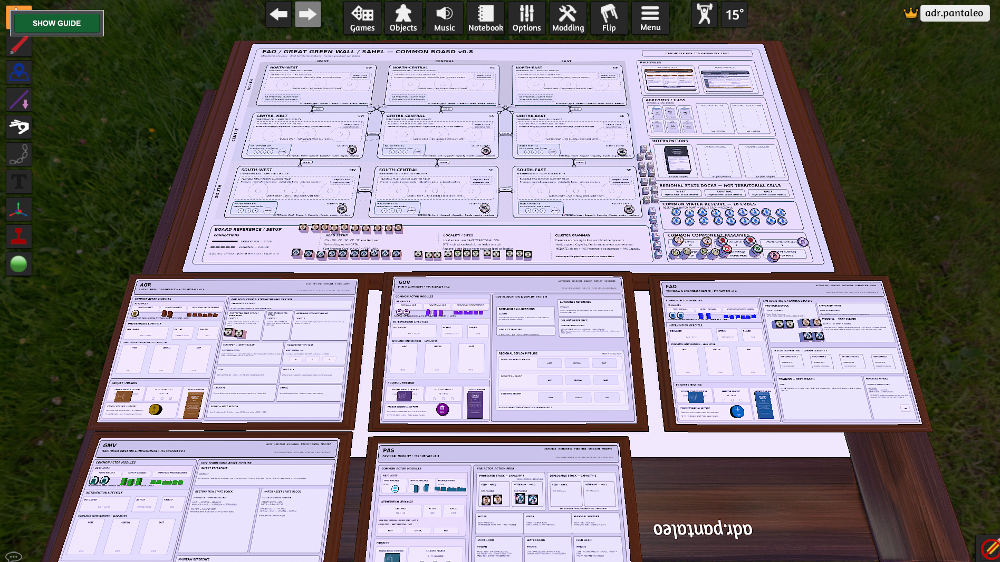

# Sahel Climate Actions
## A Great Green Wall Multi-Actor Serious Game Prototype

**Citable release:** [v2.5-human-playtest-candidate](https://github.com/Adonair4692/sahel-climate-actions-serious-game/releases/tag/v2.5-human-playtest-candidate)

**Version:** 2.5 — TTS Human Playtest Candidate  
**Release date:** 18 August 2026  
**Designer & Developer:** Adriano Pantaleo  
**Platform:** Tabletop Simulator

## Overview

**Sahel Climate Actions** is a five-role cooperative-competitive institutional serious-game prototype exploring coordination under climate, territorial and resource pressure in the Sahel.

Five asymmetric actors control different parts of the response chain:

- **GOV** — public authority;
- **FAO** — technical and logistical enabler;
- **GMV** — territorial investor and implementer;
- **AGR** — agricultural organization;
- **PAS** — pastoral organization.

The system connects authorization, finance, technical support, territorial restoration, agricultural production, pastoral mobility, common water and climate information across four simulated years and twenty-four bimonthly seasons.

## Prototype scale

- 5 asymmetric actor roles;
- 25 actor actions;
- 9 territorial cells in a 3×3 West/Central/East × North/Centre/South matrix;
- 14 permanent territorial connections;
- 6 Water Points;
- 24 Progress cards;
- 36 AGRHYMET/CILSS Forecast–Outcome pairs / 72 faces;
- 75 Intervention cards;
- 25 Project cards;
- 25 Secret Missions;
- **185 logical cards / 370 faces** overall;
- 5 private TTS Hidden Zones;
- custom Lua **Guided Turn Manager**.

## Core play rhythm

The canonical actor sequence is:

`Negotiation Window → GOV → FAO → GMV → AGR → PAS`

Climate-information pressure escalates by year:

- **Year 1:** 0 AGRHYMET/CILSS pairs per season + one ordinary actor cycle;
- **Year 2:** 1 pair per season;
- **Year 3:** 2 pairs per season;
- **Year 4:** 3 pairs per season.

Each active pair follows:

`Forecast → complete GOV-to-PAS preparation cycle → Outcome`

## Guided Turn Manager

The public source candidate is:

`src/turn-manager-v0.4.lua`

The guide remains guidance-only: players manipulate components and assess legality themselves. Current features include:

- card-setup tutorial;
- Progress and AGRHYMET/CILSS sequencing;
- correct Y1/Y2/Y3/Y4 pair escalation of 0/1/2/3;
- FULL / COMPACT / HIDDEN visibility modes;
- persistent `SHOW GUIDE` recovery control;
- TOP / BOTTOM placement;
- HIGH / DIM opacity;
- tutorial text ON / OFF;
- BACK / NEXT navigation;
- save-state persistence and migration from earlier tutorial schemas.

## Documentation included

The repository package contains the v2.5 Rulebook, Master Playbook, Setup & Season Reference, Canonical Timing Reference, five Actor Dossiers, TTS setup/runtime notes and the Guided Turn Manager source.

The full internal Master Package, production card sheets, structured design registers and archival sources are maintained separately from this public repository package.

## Release status

This is a **Human Playtest Candidate**, rather than a final validated release. The assembled TTS table is ready for structured human playtesting. Remaining release-quality checks include the full live tutorial ladder through Years 1–4, Final Resolution, save/reload continuity and external-load verification.

See [`playtest/status.md`](playtest/status.md).

## Public-status statement

This is an **independently developed serious-game prototype** for research, design, portfolio and human-playtest purposes. Institutional names and policy contexts are represented as subject matter and gameplay roles. The prototype must not be represented as an official, commissioned or endorsed FAO, Great Green Wall, AGRHYMET or CILSS product unless such status is formally established.

The game is a simulation and learning artifact rather than an operational forecasting system, official policy instrument or predictive model.

## Citation

Machine-readable citation metadata are provided in [`CITATION.cff`](CITATION.cff). Zenodo metadata are staged in [`.zenodo.json`](.zenodo.json). The DOI field will be added after reservation or publication of the archival release.

## Rights and redistribution

Documentation, original game materials and media are provided under **CC BY-NC-ND 4.0**, subject to third-party rights. Lua source code under `src/` remains **all rights reserved**. See [`RIGHTS.md`](RIGHTS.md) for the applicable terms before reuse or redistribution.

## Suggested repository topics

`serious-games` · `tabletop-simulator` · `simulation` · `sahel` · `great-green-wall` · `climate-resilience` · `land-restoration` · `pastoralism` · `agriculture` · `lua`
